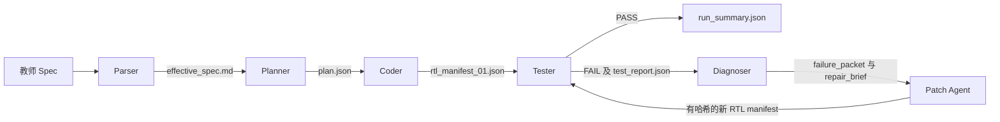

# 作业二 RV32I L3 乱序 EDA Agent 实验报告

目标项目为 `rv32i5_ooo`，对应 L3 Cache、动态分支预测和乱序执行。采用库辅助的 Hybrid Agent。Parser 和 Planner 冻结课程规格及接口，Coder 复用九个有状态或互连模块，由模型生成整数执行模块。Tester 用课程教师 TB 验收每个候选，再对功能通过的候选执行课程 PPA。实测结论和逐轮记录见下文。

## Agent 流程



| 节点 | 输入和职责 | 交接产物 |
| --- | --- | --- |
| Parser | 读取本项目完整的教师 Spec。该规格已给出时序、接口及验收，直接冻结。 | `effective_spec.md` 和含 SHA-256 的解析记录 |
| Planner | 校验 Spec 版本，冻结十个模块的 ANSI 端口以及七组跨模块握手。 | `plan.json` |
| Coder | 加载九个复用模块。根据局部执行单元规格生成 `execute_unit.sv`。逐文件验证接口，对生成模块单独做 Icarus 检查。 | 按文件记录 artifact、SHA-256、字节数和版本轮次的 RTL manifest |
| Tester | 校验 manifest 中的哈希，合并 RTL，用教师 TB 指定 `expected_cpu_level=3`，通过后收集 PPA。 | 每轮 `test_report.json`、教师输出、仿真 trace、指标和活动文件 |
| Diagnoser | 从报告提取失败阶段、第一批偏差、分组检查、失败指纹和有限日志。根据模块职责选择一至两个文件。 | `failure_packet_XX.json` 与 `repair_brief_XX.json` |
| Patch Agent | 读取 brief、指定文件及其端口和局部约束。输出 JSON 锚定编辑。校验路径、锚点唯一性、空修改和端口一致性。 | `patch_XX.json`、新 manifest 和有改动文件的快照 |

两段修复各自用独立请求。Brief 保留根因假设、置信度、相关文件与符号、验证目标和首批证据。Patch Agent 最多读取两个文件，源码上限为 24 KiB。每个补丁检查 packet 与输入 manifest 的 SHA-256，成功后只为改动文件写新快照，旧 manifest 仍可定位原版本。Tester 保留原报告。每个 model step 另存实际请求、返回文本、API usage 和完成原因，`run_summary.json` 汇总整次运行。

## L3 微架构

- I/D Cache 分别为 16 行、每行 4 字，直接映射。D 侧对 store 执行写分配、字节合并和写直达。I 侧在重定向时丢弃错误 epoch 的响应，已经向总线提出的字保持到握手。
- 16 项带 tag 的 BTB 与 16 项两位饱和 BHT 在取指时给出预测。解析后比较该条指令实际与预测的下一 PC。正确预测继续取指，误预测按 ROB 年龄清除年轻项。
- 40 个物理寄存器、8 项 ROB、8 项整数 IQ、8 个按 ROB tag 定位的 LSQ 槽。IQ 根据物理寄存器 ready 位选取可执行的最老整数指令。分支按程序顺序解析，以免错误路径分支训练预测器。目的寄存器先写 PRF，调试读口只经已提交映射读取。
- 分支分派时保存 RAT 与分配头指针。恢复点包含分支自己的分配，使 JAL/JALR 链接寄存器随分支保留。恢复时只回收年轻目的寄存器，保留较老提交推进的空闲队列尾指针。
- L3 采用 ROB head 发起访存，简化内存顺序和写副作用控制。等待 D miss 时，年轻独立整数指令仍可发射。ECALL 阻断年轻分派，老 store 完成写直达后才能退休。ECALL 退休后一拍置位 `halted` 和 `exit_code`。

## 尝试与改进

| 尝试 | 结果 | 改进或后续验证 |
| --- | --- | --- |
| 模型服务探测 | 短流式请求返回 OK，服务响应未附 usage。 | 正式测量用非流式请求读取 API usage。 |
| 首次执行模块生成和教师 TB | 2,136 tokens，生成用时 7.358 秒。编译通过，基础 ALU 的 3 个寄存器移位结果失败。Cache、Predictor、OoO 套件分别通过。 | 比对 R 型和 I 型移位。R 型必须读 `b[4:0]`，I 型才读 `insn[24:20]`。原始候选和 TB 日志保存在 `runs/l3-development`。 |
| 修正参考模块 | 教师 TB 达到 verified L3，21 项测试和 127,737 条检查通过。 | 把移位量来源写入 Coder 的局部规格，作为三次独立生成的共同约束。 |
| 首次三次 Hybrid 生成 | 教师 TB 3/3 首轮通过。各消耗 1,716、2,101、2,443 tokens，用时 7.779、13.975、10.566 秒。Yosys 前端拒绝内联 `genvar`，这些用时不含成功的标准单元映射。 | 对 Yosys 0.9 逐步兼容并复测。 |
| 初版分段修复回放 | 同一真实失败执行模块。修复一轮只改对 SLL，第二轮回退，第三轮再次只修好 SLL。共 4 次 Tester、11,648 tokens、25.865 秒，最终仍有 SRL/SRA 失败。 | 让补丁读取适用的局部 ISA 合同，并检查所有存在相同根因的操作码。 |
| 改进后同样本回放 | 只编辑 `rtl/execute_unit.sv`，一轮补丁修复三种 R 型移位。第 2 次 Tester 达到 verified L3。诊断与补丁合计 7,480 tokens、10.873 秒，PPA 仍遇到旧前端兼容问题。 | 用最终兼容版再回放，结果列于运行表。 |
| PPA 兼容性迭代 | 首轮 Yosys 0.9 不接受循环内 `integer`。随后依次暴露内联 `genvar`、动态 ready 位写入和 IQ 中嵌套索引。 | 外置循环变量及 `genvar`。按物理寄存器静态生成 ready 更新，并在 IQ 按槽计算操作数 ready。最终完成 Yosys 与 OpenSTA。 |
| 补充回归 | 13 条按预期 PC 退休、一次正确 store、3 次与 D miss 等待重叠。 | 覆盖 ROB 满载、年轻写回后的 squash、WAR/WAW、错误路径 store 和 ECALL、字节写以及 JAL 链接寄存器。测试位于 `tests/rtl/l3_recovery_tb.sv`。 |

工程接线时还遇到 WSL 在默认沙箱中无法启动、Windows 参数转义导致一次仿真命令找不到 TB，以及新模块的 Python 循环导入。分别通过在 WSL 运行课程工具、使用脚本传参和移除顶层循环依赖解决。这些尝试未产生模型设计结果。

## 对照实验

| 方法 | 条件 | 结果 | API tokens | 墙钟 |
| --- | --- | --- | ---: | ---: |
| 原流程端到端 | 同模型、温度 0、关闭思考，单次输出上限 2,400 | Planner 输出被截断，未进入教师 TB | 32,074 | 33.669 s |
| 原流程端到端 | 输出上限 8,192，模型调用上限 5 | Planner 完成，Coder 生成三个模块后达调用上限，未进入教师 TB | 102,361 | 80.654 s |
| 原 Modifier 回放 | 同一失败候选与首次失败报告，1 次修复 | 教师 TB verified L3 | 33,589 | 16.998 s |
| 分段修复回放 | 同一失败候选，1 次诊断和 1 次修复，额外复跑首轮 TB | 教师 TB verified L3 | 7,480 | 10.873 s |

同样本修复的累计 API token 降低 77.7%。旧 Modifier 输入 31,501 tokens，两个新节点共输入 7,053 tokens。旧 Modifier 成功完成修复，因此该对照衡量的是成功修复的上下文开销。端到端对照受限于明确列出的输出与调用预算，且 Hybrid 复用了组件库。

## 最终运行与 PPA

| 运行 ID | 路径 | 教师 TB | Tester 轮次 | API tokens | 墙钟 | 映射面积 | 总功耗 |
| --- | --- | --- | ---: | ---: | ---: | ---: | ---: |
| `agent-20261109T144446041958` | 最终参考 | verified L3 | 1 | 0 | 103.975 s | 252,219.6534 | 29.2 mW |
| `agent-20261109T144522544071` | Hybrid 独立生成 1 | verified L3 | 1 | 2,134 | 109.899 s | 252,190.5568 | 29.2 mW |
| `agent-20261109T144721585590` | Hybrid 独立生成 2 | verified L3 | 1 | 2,351 | 112.356 s | 252,372.1759 | 29.2 mW |
| `agent-20261109T144926109204` | Hybrid 独立生成 3 | verified L3 | 1 | 2,162 | 110.987 s | 252,190.5568 | 29.2 mW |
| `agent-20261109T144812633207` | 最终库加失败样本回放 | verified L3 | 2 | 7,603 | 111.733 s | 252,218.7148 | 28.6 mW |

最终版独立模型生成 **3/3 首轮通过**，每次 21 项测试、127,737 条检查。API token 中位数为 2,162。100% 是本组三个独立样本的观察比例，后续生成仍须由 Tester 验收。最终库的失败样本回放在一次模型补丁后通过 TB、映射与功耗估算。该行 token 和耗时从回放启动计算，首次失败 RTL 的生成成本另列于尝试表。

独立 Hybrid 样本使用本机已配置的 DeepSeek-V4.1-Flash，温度 0，关闭思考。Coder、Diagnoser、Patch Agent 的输出上限分别为 2,400、600、1,800。墙钟包含模型请求、仿真及映射和功耗估算，部分实验与其他实验并行。参考模式使用已验证组件，API 调用为零。PPA 使用 Icarus 11.0、Yosys 0.9、`gscl45nm.lib`、OpenSTA 3.2.0、课程功耗 TB 与 10 ns 时钟约束。功耗为课内工具的估算值。

## 教师 Benchmark

| Benchmark | 退休指令 | 周期 | CPI | 分支误预测 | OoO 旁路 | 外部 D 读 |
| --- | ---: | ---: | ---: | ---: | ---: | ---: |
| trained_branch64 | 132 | 148 | 1.121 | 2/64 | 未输出 | 未输出 |
| teaching_crc32_64bytes | 3,185 | 4,006 | 1.258 | 312/1,088 | 7 | 16 |
| teaching_array_sum64 | 324 | 741 | 2.287 | 2/64 | 15 | 64 |
| teaching_branch_predict64 | 293 | 480 | 1.638 | 66/128 | 0 | 0 |
| teaching_ooo_overlap64 | 516 | 1,583 | 3.068 | 2/64 | 16 | 64 |

教师套件 `base`、`cache`、`predictor`、`ooo`、`performance_correctness` 全部通过。热循环训练为 64 次解析和 2 次误预测，低于课程门槛 8 次。教师乱序探针要求同时观测到真实发射、旁路和与 D 等待重叠。访存密集负载仍受 ROB head 发起访存和阻塞式 D-Cache 限制。复杂分支负载暴露了 16 项 BTB/BHT 的有限预测能力。周期以教师 TB 的各次运行边界计数，包含本次运行内部的冷缓存填充和训练。

## 复现与证据

在项目根目录用 Ubuntu WSL 和课程虚拟环境运行。

```bash
.venv/bin/python -m ai_eda agent --project rv32i5_ooo
.venv/bin/python -m ai_eda agent --project rv32i5_ooo --l3-mode reference
.venv/bin/python -m ai_eda agent --project rv32i5_ooo --l3-mode legacy --max-calls 5
```

工作台运行入口为 `make web` 后选择 RV32I · L3 OoO。模型模式使用本地 `ModelClient` 配置和课程 API Key。参考模式可离线复现 RTL、教师 TB 和 PPA。补充回归命令如下。

```bash
iverilog -g2012 -s l3_recovery_tb -o /tmp/l3_recovery.vvp \
  tests/rtl/l3_recovery_tb.sv content/agent/skills/rv32i5_ooo/*.sv
vvp /tmp/l3_recovery.vvp
```

- 教师 Spec 冻结哈希为 `0ff959abf7f5cbd2669691d19b11fb6ccd7b0eb1884a5924ece4d542a5ffa89d`。
- [实测摘要](rv32i5_l3_evidence.json)保留每次正式运行的 ID、节点参数、usage、教师套件结果和 PPA。完整现场记录位于本机 `runs/agent/<run_id>`，包括 `step-*/conversation.json`、`tester-*/test_report.json` 和按轮次保存的 artifact。
- 初始失败样本位于 `runs/l3-development/execute-first.sv`，对应日志为 `tb-01.log`。手工修正后的教师验收位于 `tb-02.log`。补充回归输出见 `recovery.log`。
- 本次工作的改造范围为作业二。现场模型配置沿用了工作区已有设置，学生原有的作业一 Prompt 与本地模型设置独立保留。
